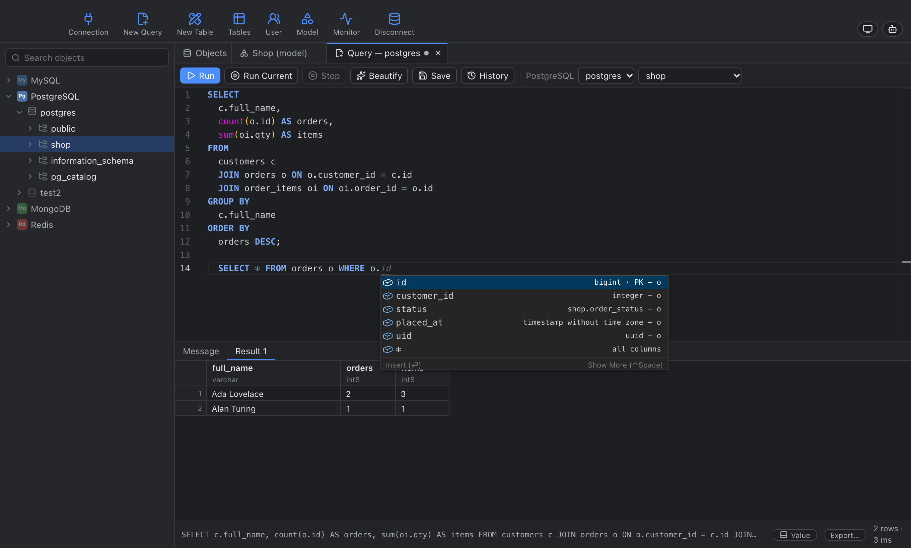
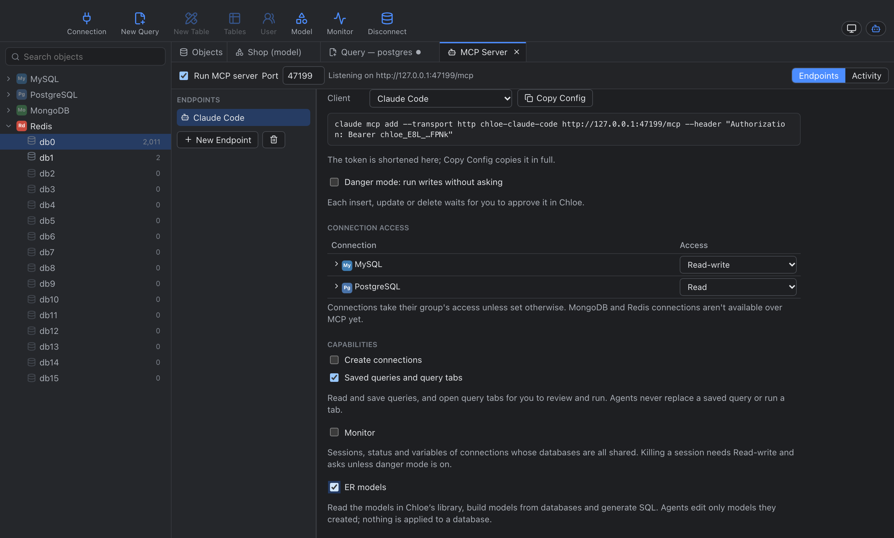
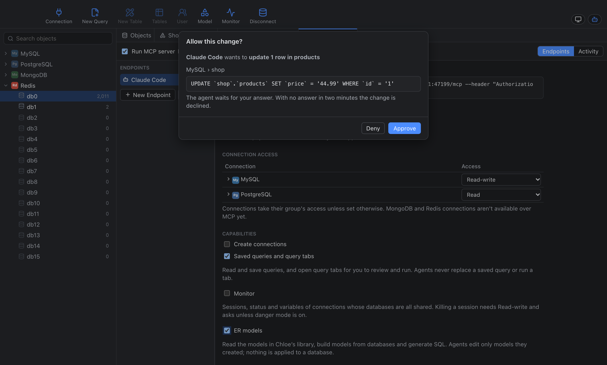
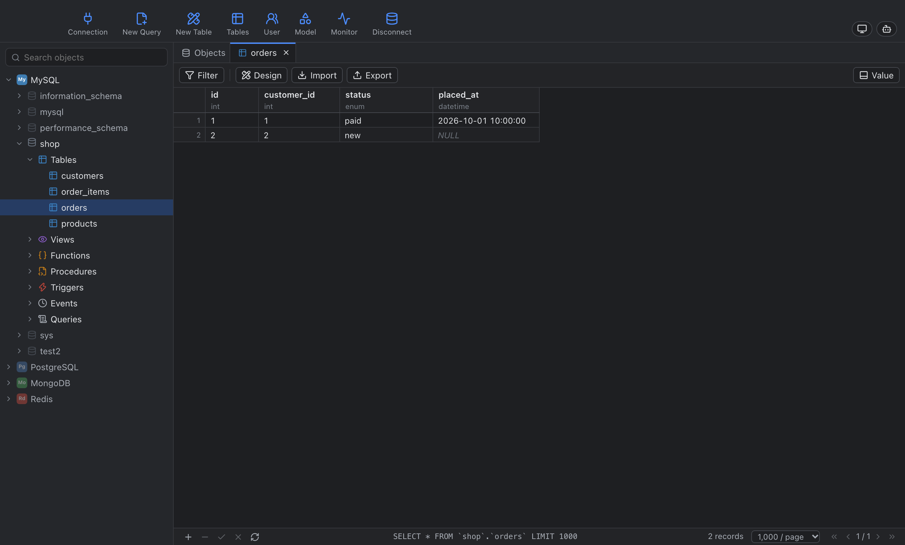
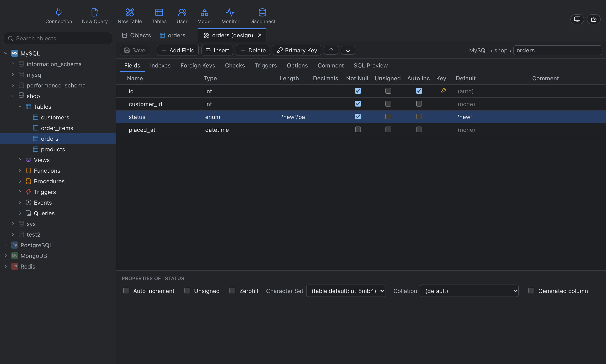
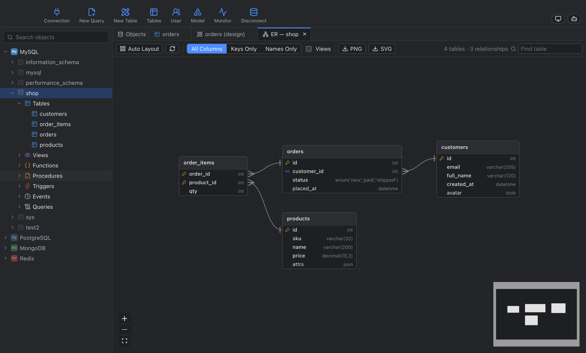
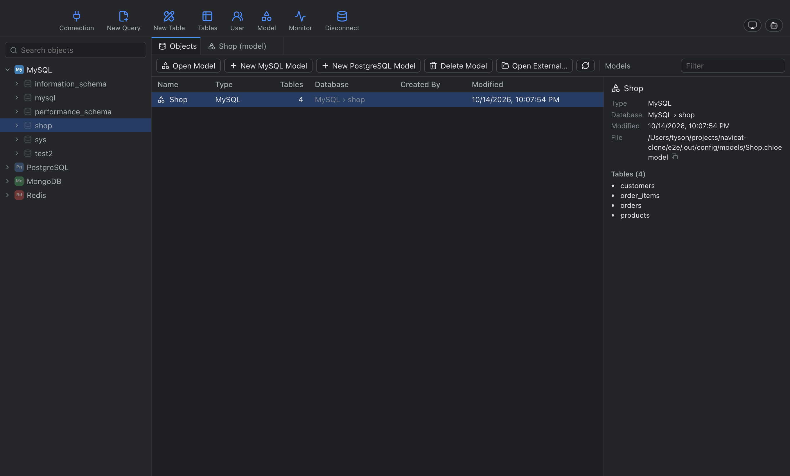
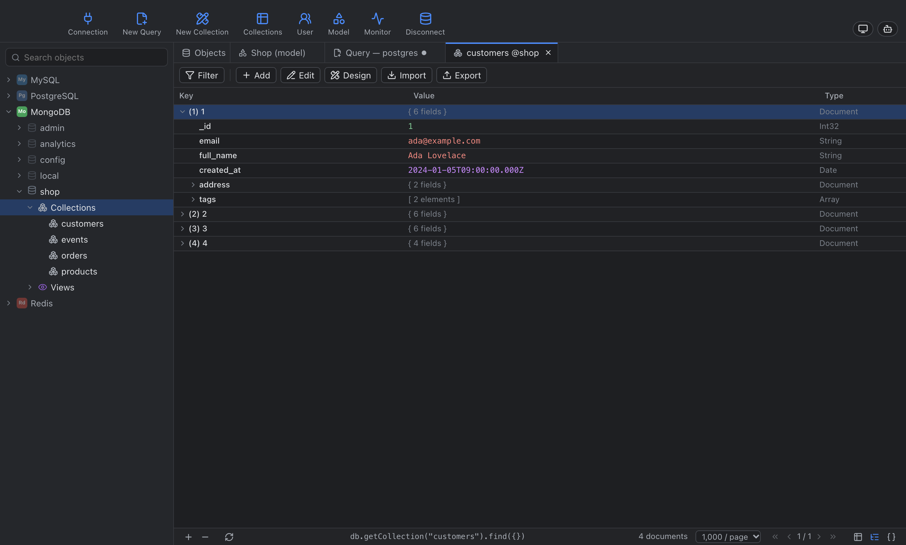
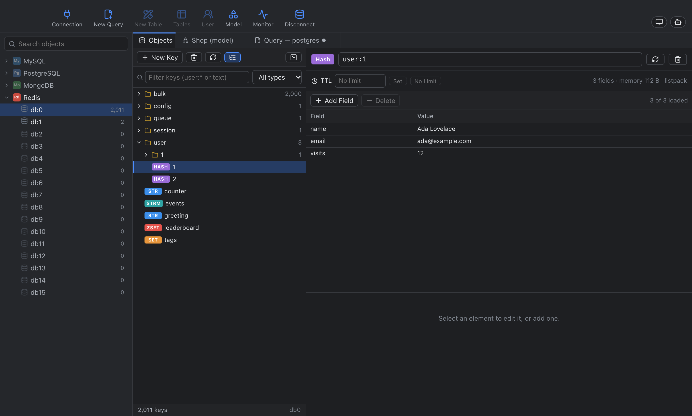

<p align="center"></p>

<h1 align="center">Chloe</h1>

<p align="center">A desktop database client for MySQL, MariaDB, PostgreSQL, SQLite, MongoDB and Redis.</p>

Chloe follows the menus, dialogs and workflows of Navicat Premium, so the layout will be familiar, and adds an
[MCP server](#mcp-server) that lets AI assistants work with your databases under your control. It is built with Go,
[Wails v3](https://v3.wails.io) (the system webview), React and Monaco.



## Supported databases

| Engine | Support |
|---|---|
| MySQL, MariaDB | Full: objects, designers, transfer and synchronization, users and privileges, server monitor |
| PostgreSQL | Full, including schemas, materialized views, sequences and types |
| SQLite | Database files and attachments, designers (with table rebuilds where `ALTER` falls short), transfer, data synchronization |
| MongoDB | Documents, shell, collection and view designers, import and export, users and roles, server monitor |
| Redis | Keys and typed values, console, server monitor |

SQL Server and Oracle are planned. See [docs/ROADMAP.md](docs/ROADMAP.md).

## Features

### Connections
- Groups with drag-and-drop ordering, SSH tunnels (password or key) and full SSL options
- Presets for hosted services (Supabase, Neon, Amazon RDS, DigitalOcean, PlanetScale, TiDB) and connection URLs
- Import and export, with passphrase-encrypted exports

### SQL development
- Monaco editor with context-aware completion: tables, columns, aliases, joins along foreign keys, enum values and
  JSON keys
- Beautify, saved queries in each database's Queries folder, a history log of every statement run, and query tabs
  that are restored after a restart
- Data grid for browsing, filtering, sorting and editing, with a value panel for long text and JSON

### Design
- Designers for tables (columns, keys, foreign keys, indexes, checks, triggers, partitions), views, functions and
  databases, each with an SQL preview before anything is applied
- ER diagrams of existing databases
- Data models: reverse engineer a database, design offline, generate SQL, and synchronize the model to any
  compatible database. Models are kept in a library that records the database each one belongs to.

### Data movement
- Import and export: CSV, TSV, JSON, SQL and Excel; dump and execute SQL files
- Data Transfer between MySQL/MariaDB, PostgreSQL and SQLite, converting types, defaults, identity columns and
  constraints
- Structure Synchronization and Data Synchronization with side-by-side differences and deployment scripts

### Administration
- Users and privileges for MySQL and PostgreSQL, users and roles for MongoDB
- Server monitor: sessions (kill a session or its query), variables and status

### Security
- Passwords are stored in the OS keychain. On macOS only Chloe's code signature can read them.
- Connections, saved queries, history and drafts are encrypted at rest with a key held in the keychain.

## MCP server

Chloe can serve your connections to AI assistants such as Claude Code and Claude Desktop over the
[Model Context Protocol](https://modelcontextprotocol.io).



- **Local only.** The server is off by default, runs only while Chloe is open, and listens on `127.0.0.1`.
- **Endpoints.** Each assistant gets its own endpoint with its own bearer token. Access is Off, Read or Read-write
  per connection group, connection and database.
- **Approval.** Agents read through structured tools and one read-only query at a time. Inserts, updates and deletes
  are built by Chloe from checked column names and bound values, never from agent SQL, and each one waits for your
  approval with the exact statement and the number of rows it affects. An opt-in danger mode skips the dialog for
  an endpoint. No DDL is ever run over MCP.
- **Capabilities.** Optional, per endpoint:
  - create connections (always approved; you can type the password into the dialog);
  - read and save queries, and open query tabs with SQL for you to review and run;
  - monitor sessions and server status;
  - build data models and generate the SQL to apply them.
- **Activity log.** Every tool call is recorded with its SQL and outcome.



To connect an assistant, open **Tools › MCP Server…**, create an endpoint, choose what it may access, and use
**Copy Config** for the client snippet. For Claude Code:

```sh
claude mcp add --transport http chloe-claude-code http://127.0.0.1:47101/mcp --header "Authorization: Bearer chloe_…"
```

Access is enforced per connection and database, not per table or column. To keep an assistant away from sensitive
tables, share a connection that signs in as a database user with limited privileges. Full details are in
[docs/specs/mcp-server.md](docs/specs/mcp-server.md).

## Screenshots

| | |
|---|---|
|  Data grid |  Table designer |
|  ER diagram |  Model library |
|  MongoDB documents |  Redis keys |

To regenerate them, run `make e2e SCRIPT=screenshots` and copy `e2e/.out/shots/readme-*.png` to
`docs/assets/screenshots/`.

## Building

Chloe requires Go 1.26 or later, Node 22 or later, and the Wails CLI:

```sh
go install github.com/wailsapp/wails/v3/cmd/wails3@v3.0.0-beta.29
```

The Makefile finds `wails3` in `$(go env GOPATH)/bin` even when that directory isn't on your `PATH`.

```sh
make dev       # run with hot reload
make build     # build bin/Chloe
make install   # macOS: build a signed Chloe.app into /Applications, replacing any previous copy
```

`make install` quits a running copy first; saved connections and keychain passwords carry over. Builds are signed
with `CHLOE_SIGN_IDENTITY` if set, otherwise with the first "Apple Development" certificate in the keychain,
otherwise ad hoc. A stable signature lets the keychain keep trusting Chloe across rebuilds.

## Testing

```sh
make test                  # Go unit tests (SQLite included; no Docker needed)
make test-it               # start and seed the Docker databases, then run the integration tests
make test-frontend         # type check and frontend unit tests
make e2e SCRIPT=sqlite     # Playwright against the browser build (smoke, sqlite, mongo, model, mcp, …)
```

`make db` (or `docker compose up -d`) starts the test databases with password `chloe`: MySQL on `:33306`,
PostgreSQL on `:55432`, MongoDB on `:37017` (user `root`) and Redis on `:63790`, seeded with the `shop` sample data
in `testdata/`.

Setting `CHLOE_CONFIG_DIR=<dir>` together with `CHLOE_SECRETS=memory` runs Chloe against an isolated configuration
without touching the keychain. The browser build (`bin/Chloe-server`) has no login, so it requires
`CHLOE_SECRETS=memory` and listens only on loopback.

## License

[MIT](LICENSE). Chloe is not affiliated with Navicat or PremiumSoft.
